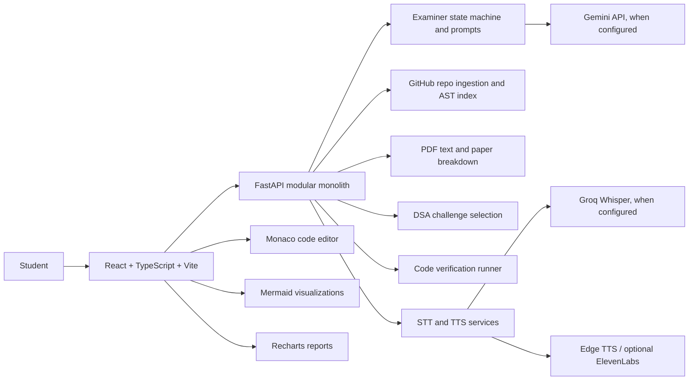

# VivaVoce

VivaVoce is an adaptive learning and technical interview practice platform. It helps students explain their own code, practice data structures and algorithms, and understand research papers through guided, interactive tools.

The core interview experience can use a GitHub repository as context: VivaVoce indexes source files, asks questions about implementation choices, listens to or accepts typed answers, and adapts follow-up questions to the student's responses. DSA practice provides coding challenges and test feedback. Research Paper Explorer is a separate study mode that breaks down a paper and links explanations and diagrams to source passages; it does not conduct an interview in that mode.

## Project modes

- **Practice Interview:** Ingest a GitHub repository, inspect relevant code, and practice explaining architecture, edge cases, and trade-offs with an adaptive examiner.
- **Coding Practice:** Work through DSA problems in an editor, run provided tests, and discuss complexity and design decisions.
- **Research Paper Explorer:** Upload a research-paper PDF and explore its problem, method, evidence, results, limitations, and terminology with source-linked visual explanations.

## Main capabilities

- Spoken answers with push-to-talk and typed-answer fallback.
- Speech-to-text through Groq when configured; speech output through Edge TTS and optional ElevenLabs integration.
- Adaptive question flow organized around recall, comprehension, analysis, and evaluation.
- Repository indexing, source highlighting, and contribution-aware context where available.
- In-browser code editing with test execution for supported challenges.
- PDF text extraction, structured paper breakdowns, clickable evidence excerpts, and concept/method diagrams.
- Demo and fallback paths for presenting without a live external AI service.

## Technology

- **Frontend:** React, TypeScript, Vite, Tailwind CSS, Monaco Editor, Mermaid, and Recharts.
- **Backend:** Python, FastAPI, and Pydantic.
- **Repository analysis:** GitPython and Python AST parsing.
- **PDF processing:** PyMuPDF.
- **AI and voice integrations:** Gemini, Groq Whisper, Edge TTS, and optional ElevenLabs.

## Repository structure

```text
backend/
  main.py                    FastAPI app and session/API orchestration
  models/schemas.py          Shared Pydantic contracts
  brain/                     Adaptive examiner, prompts, grading, DSA logic
  ingestion/                 GitHub repository and PDF analysis
  sandbox/                   Challenge verification runner
  voice/                     Speech recognition and speech synthesis
  demo_cache/                Sample repository and sample research paper
frontend/
  src/components/            Home, interview, DSA, paper, editor, report UI
  src/services/              API client, audio capture/playback, demo fallback
docs/                        Project documentation
```

## Run locally

### Requirements

- Python 3.10 or newer
- Node.js and npm
- Optional API credentials: `GEMINI_API_KEY`, `GROQ_API_KEY`; `ELEVENLABS_API_KEY` and `ELEVENLABS_VOICE_ID` are optional for that TTS provider

### Backend

From the repository root, create a virtual environment and install dependencies:

```powershell
python -m venv .venv
.\.venv\Scripts\Activate.ps1
pip install -r backend/requirements.txt
```

Set optional credentials in the terminal session, then start FastAPI:

```powershell
$env:GEMINI_API_KEY = "your-gemini-key"
$env:GROQ_API_KEY = "your-groq-key"
uvicorn backend.main:app --reload --host 127.0.0.1 --port 8000
```

API documentation: `http://127.0.0.1:8000/docs`.

### Frontend

In a second terminal:

```powershell
cd frontend
npm install
npm run dev
```

Open the local URL printed by Vite, usually `http://localhost:5173`. The Vite development server proxies `/api` requests to the backend on port 8000.

## Demo suggestions

- Start the backend and frontend before presenting.
- Use the bundled sample repository for a code interview and the bundled sample PDF for paper exploration.
- Verify speech input/output before the demo; keep typed answers available as a fallback.
- Explain clearly which flows use live API credentials and which use demo or deterministic fallback data.

## API overview

The FastAPI app includes routes for health, repository/PDF/DSA ingestion, interview turns, code verification, reports, and voice support. Browse `/docs` on the running backend for the current request/response schemas.

## Important prototype limitations

- External AI and voice services require valid network access and credentials.
- PDF extraction depends on selectable text; scanned papers need OCR support.
- Repository parsing and code execution support a bounded prototype workflow, not every language or repository layout.
- A short subprocess timeout is not equivalent to a production-grade security sandbox. Do not run untrusted code outside a properly isolated environment.
- AI-generated questions, explanations, and scores can be imperfect; source context and human review remain important.

## Documentation

- [System architecture](docs/SYSTEM_ARCHITECTURE.md)
- [Project guide](docs/PROJECT_GUIDE.md)
- [Initial submission description](docs/PROJECT_DESCRIPTION.md)

---

# VivaVoce System Architecture

## Product overview

VivaVoce combines technical interview practice, DSA practice, and a separate research-paper study experience. The interview and DSA flows use an adaptive examiner that can communicate by voice or text. The paper explorer focuses on explaining a PDF with visual structure and source evidence; it is not an interview flow.

## High-level architecture



The backend is organized as a modular monolith: one FastAPI application coordinates analysis, session state, voice integrations, and responses. The frontend is a Vite application that calls the backend through `/api`.

## Frontend modules

- **`App.tsx`** — top-level navigation among home, project interview, DSA practice, and research paper screens.
- **`HomePage.tsx`** — entry point to the learning modes.
- **`ProjectPage.tsx`** — repository-based technical interview workspace.
- **`DsaPage.tsx`** — coding-practice challenges and examiner interaction.
- **`ResearchPage.tsx` / `PaperWorkspace.tsx`** — paper upload, breakdown, diagrams, evidence, and paper study UI.
- **`ExaminerPanel.tsx`** — voice/text interview controls and turn display for interview modes.
- **`IdeWorkspace.tsx`** — Monaco editor, file tree, highlighted code, and challenge execution UI.
- **`ReportModal.tsx`** — post-session report and rubric presentation.
- **`apiClient.ts` / `audioRecorder.ts`** — API communication and browser audio capture/playback.

## Backend modules

- **`backend/main.py`** — FastAPI app, route wiring, mode orchestration, session lifecycle.
- **`backend/models/schemas.py`** — Pydantic request/response contracts shared across backend flows.
- **`backend/brain/state_machine.py`** — adaptive interview turn progression, answer evaluation/fallback behavior, and question selection.
- **`backend/brain/prompts.py` and `grader.py`** — prompt definitions and report scoring.
- **`backend/brain/dsa_coach.py`** — DSA profile/problem support.
- **`backend/ingestion/repo_parser.py` and `git_blame.py`** — repository retrieval/indexing, code structure, and contributor mapping.
- **`backend/ingestion/pdf_parser.py` and `paper_breakdown.py`** — page-level PDF extraction, section analysis, diagrams, and evidence-linked report.
- **`backend/voice/`** — speech-to-text and text-to-speech integration, audio handling, and voice API routes.
- **`backend/sandbox/sandbox_runner.py`** — time-bounded code verification used by coding challenges.

## Main flows

### Repository interview

1. Student submits a GitHub URL (or uses a cached demo repository).
2. Backend retrieves/indexes supported source files and prepares repository context.
3. Examiner starts a session with a question grounded in the code.
4. Student answers by voice or text.
5. Voice input is transcribed when STT is configured; the examiner evaluates the response and selects a follow-up.
6. The UI can show the relevant code file/line range and speak the next prompt.
7. A session report summarizes performance and topic depth.

### DSA practice

1. Student chooses a supported problem.
2. The IDE displays starter code and test cases.
3. Student edits code and asks the backend to run verification.
4. Test results and the examiner’s follow-up support discussion of correctness, complexity, and edge cases.

### Research paper study

1. Student uploads a PDF or loads the cached sample.
2. PyMuPDF extracts text by page; the parser identifies sections and candidate concepts.
3. Gemini may assist in generating a paper-specific concept/method map; local fallback logic is used if the service is unavailable.
4. The backend returns structured paper fields, diagram nodes, and page-linked excerpts.
5. The UI displays the paper breakdown and lets the student inspect source evidence.

## External services and configuration

- **Gemini:** Used for AI-assisted question/analysis generation where configured. `GEMINI_API_KEY` is read from the environment.
- **Groq Whisper:** Used for speech transcription. `GROQ_API_KEY` enables STT; typed answers remain a fallback.
- **Edge TTS:** Primary speech synthesis path in the voice module; optional ElevenLabs credentials can enable its integration.
- **Frontend proxy:** Vite routes `/api` to `http://localhost:8000` in development.

Missing keys may result in fallback or reduced functionality. The exact status can be checked through the health endpoints and backend logs.

## Trust and safety boundaries

- Paper claims and generated explanations should remain distinguishable and linked to the source where possible.
- Speech recognition and automated grading can be wrong; scores are practice feedback, not formal assessment.
- A short subprocess timeout does not establish a secure code sandbox. Production use with untrusted code requires stronger OS/container isolation, resource limits, and network restrictions.
- Treat uploaded PDFs and repository content as untrusted inputs. Do not execute document content.
