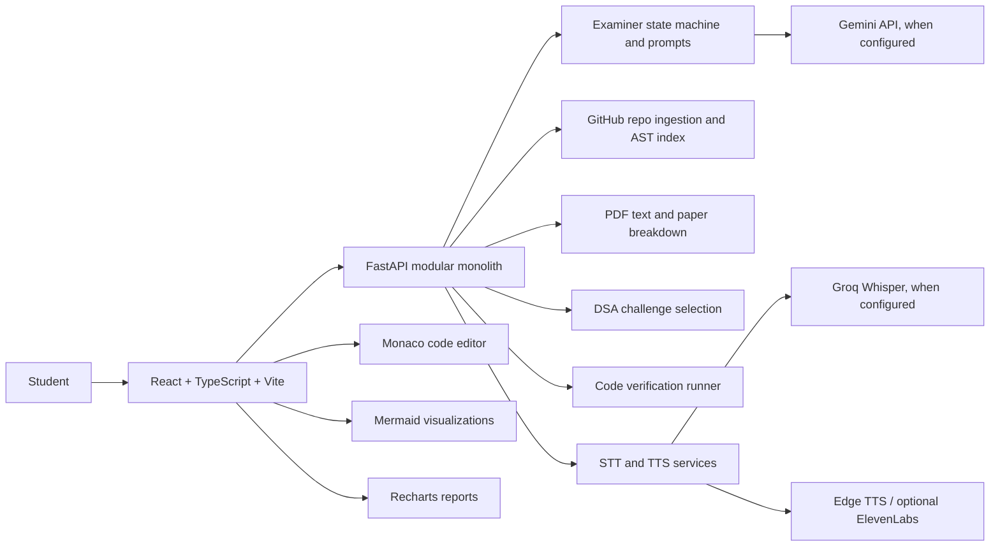

# VivaVoce System Architecture

## Product overview

VivaVoce combines technical interview practice, DSA practice, and a separate research-paper study experience. The interview and DSA flows use an adaptive examiner that can communicate by voice or text. The paper explorer focuses on explaining a PDF with visual structure and source evidence; it is not an interview flow.

## High-level architecture

The backend is organized as a modular monolith: one FastAPI application coordinates analysis, session state, voice integrations, and responses. The frontend is a Vite application that calls the backend through `/api`.

## Frontend modules

- **`App.tsx`** — top-level navigation among home, project interview, DSA practice, and research paper screens.
- **`HomePage.tsx`** — entry point to the learning modes.
- **`ProjectPage.tsx`** — repository-based technical interview workspace.
- **`DsaPage.tsx`** — coding-practice challenges and examiner interaction.
- **`ResearchPage.tsx` / `PaperWorkspace.tsx`** — paper upload, breakdown, diagrams, evidence, and paper study UI.
- **`ExaminerPanel.tsx`** — voice/text interview controls and turn display for interview modes.
- **`IdeWorkspace.tsx`** — Monaco editor, file tree, highlighted code, and challenge execution UI.
- **`ReportModal.tsx`** — post-session report and rubric presentation.
- **`apiClient.ts` / `audioRecorder.ts`** — API communication and browser audio capture/playback.

## Backend modules

- **`backend/main.py`** — FastAPI app, route wiring, mode orchestration, session lifecycle.
- **`backend/models/schemas.py`** — Pydantic request/response contracts shared across backend flows.
- **`backend/brain/state_machine.py`** — adaptive interview turn progression, answer evaluation/fallback behavior, and question selection.
- **`backend/brain/prompts.py` and `grader.py`** — prompt definitions and report scoring.
- **`backend/brain/dsa_coach.py`** — DSA profile/problem support.
- **`backend/ingestion/repo_parser.py` and `git_blame.py`** — repository retrieval/indexing, code structure, and contributor mapping.
- **`backend/ingestion/pdf_parser.py` and `paper_breakdown.py`** — page-level PDF extraction, section analysis, diagrams, and evidence-linked report.
- **`backend/voice/`** — speech-to-text and text-to-speech integration, audio handling, and voice API routes.
- **`backend/sandbox/sandbox_runner.py`** — time-bounded code verification used by coding challenges.

## Main flows

### Repository interview

1. Student submits a GitHub URL (or uses a cached demo repository).
2. Backend retrieves/indexes supported source files and prepares repository context.
3. Examiner starts a session with a question grounded in the code.
4. Student answers by voice or text.
5. Voice input is transcribed when STT is configured; the examiner evaluates the response and selects a follow-up.
6. The UI can show the relevant code file/line range and speak the next prompt.
7. A session report summarizes performance and topic depth.

### DSA practice

1. Student chooses a supported problem.
2. The IDE displays starter code and test cases.
3. Student edits code and asks the backend to run verification.
4. Test results and the examiner’s follow-up support discussion of correctness, complexity, and edge cases.

### Research paper study

1. Student uploads a PDF or loads the cached sample.
2. PyMuPDF extracts text by page; the parser identifies sections and candidate concepts.
3. Gemini may assist in generating a paper-specific concept/method map; local fallback logic is used if the service is unavailable.
4. The backend returns structured paper fields, diagram nodes, and page-linked excerpts.
5. The UI displays the paper breakdown and lets the student inspect source evidence.

## External services and configuration

- **Gemini:** Used for AI-assisted question/analysis generation where configured. `GEMINI_API_KEY` is read from the environment.
- **Groq Whisper:** Used for speech transcription. `GROQ_API_KEY` enables STT; typed answers remain a fallback.
- **Edge TTS:** Primary speech synthesis path in the voice module; optional ElevenLabs credentials can enable its integration.
- **Frontend proxy:** Vite routes `/api` to `http://localhost:8000` in development.

Missing keys may result in fallback or reduced functionality. The exact status can be checked through the health endpoints and backend logs.

## Trust and safety boundaries

- Paper claims and generated explanations should remain distinguishable and linked to the source where possible.
- Speech recognition and automated grading can be wrong; scores are practice feedback, not formal assessment.
- A short subprocess timeout does not establish a secure code sandbox. Production use with untrusted code requires stronger OS/container isolation, resource limits, and network restrictions.
- Treat uploaded PDFs and repository content as untrusted inputs. Do not execute document content.
